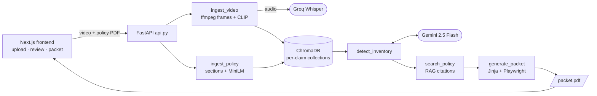
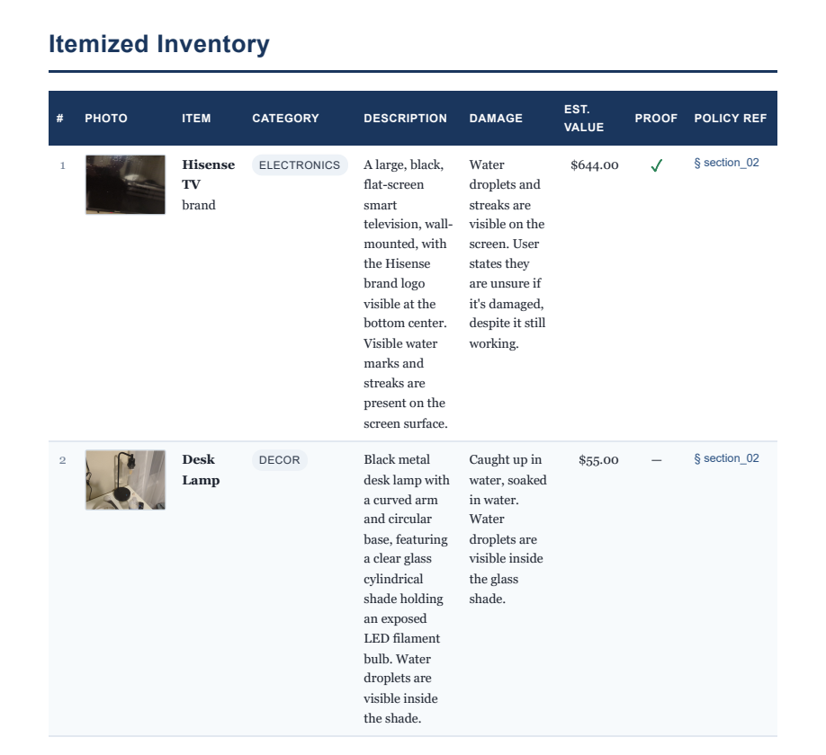

# Claim-ready

**Turn an insurance claimant's video walkthrough and policy PDF into a submission-ready claim packet — in under three minutes.**

Built solo at Hook 'Em Hacks 2026 · Multimodal Search & Generation track.

---

## 🚀 Live

- **Landing page:** https://claim-ready-hookem.vercel.app
- **Demo video:** https://www.youtube.com/watch?v=ovHGdx5eG28
- **GitHub:** https://github.com/peroute/claim-ready

> The Vercel link hosts the frontend. The full pipeline (CLIP + Whisper + Gemini + ChromaDB + Playwright) runs on a local Python backend — see the Quick Start below to run it end-to-end, or watch the demo video for a full walkthrough.

---

## The problem

Insurers have spent billions building AI to evaluate claims. Policyholders have almost nothing. When something gets damaged, the average claimant submits blurry photos, can't cite their own policy, and accepts whatever the adjuster offers. **Most people never push back on a low offer, because building a well-documented claim is hard.**

Claim-ready closes that gap.

## What it does

1. **Upload** a damage walkthrough video (MP4/MOV) and a policy PDF.
2. **Process** — keyframes extracted, audio transcribed, both indexed into ChromaDB. Gemini 2.5 Flash + CLIP detect every damaged item that's either visible in a frame or named in the narration.
3. **Cite** — each detected item is matched against the relevant clauses of the policy using semantic RAG.
4. **Render** — a polished PDF packet is produced: cover page, AI-generated incident summary, FNOL letter, itemized inventory with thumbnails pulled from the source video, and excerpts of the policy sections that cover each item.
5. **Review** — claimant edits values, attaches receipts, deletes false positives in a clean review UI, then regenerates the final packet.

## Why it's on the Multimodal Search & Generation track

Three search layers, all load-bearing:

- **Policy RAG** — semantic text search over policy sections, citing the clause that covers each damage item.
- **Video evidence retrieval** — every inventory item links back to the exact second of video where it was discussed. Click a row → video seeks.
- **Cross-modal item detection** — per-window Gemini Vision calls use the keyframe image *and* the aligned narration text together to correlate "that" with the object being pointed at.

Generation spans four modalities:

- **Audio** (Whisper narration transcript)
- **Image** (CLIP-embedded keyframes, per-window vision calls)
- **Text** (policy embedding, generated incident summary + FNOL letter)
- **Video** (source walkthrough, replayable at every item timestamp)

## Stack

| Layer | Tech |
| --- | --- |
| Frontend | Next.js 14 (App Router) · TypeScript · Tailwind · shadcn/ui |
| Backend | FastAPI · Python 3.11+ |
| Vision + Generation | Google `gemini-2.5-flash` |
| Audio | Groq `whisper-large-v3` |
| Embeddings | OpenAI CLIP `ViT-B-32` (image), `all-MiniLM-L6-v2` (text) |
| Vector Store | ChromaDB (persistent, per-claim collections) |
| PDF | Jinja2 → Playwright (headless Chromium) |
| Hosting | Vercel (frontend) |

## Quick start

### Backend (port 8000)

```bash
cd backend
python -m venv ../.venv
../.venv/Scripts/Activate.ps1   # or: source ../.venv/bin/activate
pip install -r requirements.txt
playwright install chromium
cp .env.example .env
# Fill in GROQ_API_KEY and GOOGLE_API_KEY
python api.py
```

### Frontend (port 3000)

In a second terminal:

```bash
cd frontend
npm install
npm run dev
```

Open http://localhost:3000, upload a video + policy, and watch it work.

### Environment variables

| Var | Where | Notes |
| --- | --- | --- |
| `GROQ_API_KEY` | `backend/.env` | Whisper transcription (`gsk_...`) |
| `GOOGLE_API_KEY` | `backend/.env` | Gemini — requires a billing-enabled project (free tier's 20 req/day is hit immediately) |
| `NEXT_PUBLIC_API_BASE` | `frontend/.env.local` | Defaults to `http://localhost:8000` |

## Architecture



### Sample packet

Itemized inventory page from a real run — thumbnails come from the video, each item cites its policy section:



### Pipeline stages (live progress in the UI)

1. `ingesting_video` — ffmpeg keyframes @ 1fps, perceptual-hash dedup, CLIP embedding
2. `ingesting_policy` — pypdf text extraction, regex section detection, MiniLM embedding
3. `building_index` — ChromaDB collections per claim
4. `detecting_inventory` — overlapping 10s windows, Gemini Vision per window, brand-aware cross-window deduplication
5. `searching_policy` — per-item RAG against policy sections
6. `generating_packet` — AI-drafted incident summary + FNOL letter, rendered via headless Chromium

## API surface

All endpoints under `http://localhost:8000` by default.

| Method | Path | Purpose |
| --- | --- | --- |
| POST | `/claims` | Upload video + policy + intake → returns `{claim_id}`, kicks off background pipeline |
| GET | `/claims/{id}/status` | Poll pipeline progress (`stage`, `percent`, `message`) |
| GET | `/claims/{id}/packet` | Packet metadata for the review UI |
| GET | `/claims/{id}/pdf` | The rendered PDF |
| GET | `/claims/{id}/video` | Source walkthrough video (range-aware) |
| GET | `/claims/{id}/frames/{frame_id}` | Individual keyframe JPG |
| POST | `/claims/{id}/regenerate` | Re-render packet from edited items |

## CLI (no frontend required)

The full pipeline runs from the command line:

```bash
cd backend
python pipeline.py test outputs/test/real-video.mp4 demo_policy.pdf
```

Output lands at `outputs/test/packet.pdf`.

## Frontend routes

| Route | What it shows |
| --- | --- |
| `/` | Upload landing page (intake form + dropzones) |
| `/claim/{id}/processing` | Live pipeline progress + stage checklist |
| `/claim/{id}/review` | Inventory table with thumbnails + video player + summary stats |
| `/claim/{id}/packet` | Final PDF preview + download |

## Design decisions

**Human-in-the-loop by design.** Gemini detection produces ~10-15 candidate items per video. Duplicates and false positives are expected — the review step is where the user verifies, edits values, attaches proof, and deletes noise before the final packet renders. The product pitch is *AI proposes, human disposes* — not *AI pretends to be perfect*.

**Policy citations over generic labels.** Every inventory item carries a policy section reference. The packet reads "covered under Section 02 — Personal Property (Coverage C)," not "probably covered."

**Evidence-linked inventory.** Each item stores the frame IDs and narration chunk IDs that produced it. In the review UI, clicking a row seeks the source video to the exact timestamp. Judges (and adjusters) can verify every claim line against its evidence.

**No web-scraping for values.** Item valuation is explicitly user-entered in V1. This is an intentional product choice: auto-scraped prices are fragile and invite fraud; receipt-backed values are what insurers actually accept. The packet separates *verified totals* (items with proof attached) from *unverified totals*, giving adjusters a credibility signal out of the box.

## Known limitations (V1 scope)

- The backend runs locally only, CORS is wide open (`allow_origins=["*"]`), and there are no tests or CI yet.

- Item value estimation is deferred to V2 — values are user-entered during the review step.
- Gemini detection requires a Tier 1 (billing-enabled) Google Cloud project.
- Whisper occasionally mis-transcribes brand names (e.g. "Highsense" for "Hisense"); per-brand fixes live in `detect_inventory.py`.
- The Vercel-deployed frontend uses a graceful fallback when the local backend isn't reachable — there's no cloud backend deployment in V1.
- In-memory progress state in `api.py` — single-server only.

## Project layout

```
claim-ready/
├── backend/
│   ├── api.py                 HTTP layer (FastAPI)
│   ├── pipeline.py            Stage orchestrator
│   ├── ingest_video.py        Frames + Whisper transcription
│   ├── ingest_policy.py       PDF parsing + section detection
│   ├── detect_inventory.py    Gemini multimodal item detection
│   ├── search_policy.py       Per-item citation lookup
│   ├── generate_packet.py     PDF rendering via Playwright
│   ├── vector_store.py        ChromaDB wrapper
│   ├── schemas.py             Shared dataclasses
│   └── templates/packet.html  Jinja template
└── frontend/
    ├── app/                   App Router routes
    ├── components/            UI components
    └── lib/                   Typed API client + hooks
```

## Credits

Built solo at Hook 'Em Hacks 2026 (April 18–19).

